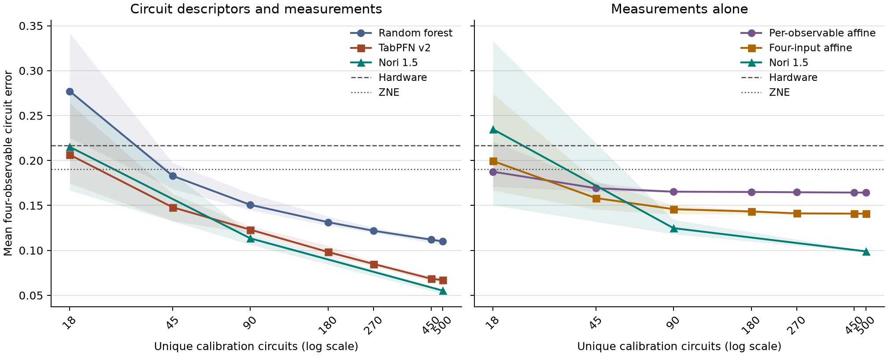

# What the ML-QEM hardware experiment establishes

Several frozen tabular checkpoints reduced four-observable error relative to the published random forest on IBM Algiers. Performance varied substantially by checkpoint. A separate, problem-specific control predicted the ideal observables more accurately using **only the known circuit parameters and calibration labels**. This four-qubit Ising task can measure predictive accuracy and the incremental value of noisy inputs. Establishing transferable error mitigation requires a further experiment that changes the hardware or circuit family.

## Reproducing the published experiment

ML-QEM supplies real noisy measurements, ideal simulation targets, ZNE outputs, the circuits themselves, and a model reference. The authors' hardware notebook selects 50 training and 250 test rows at each depth 0–9. We used the same 169 inputs, ideal targets, row IDs and four independent scalar predictions per circuit. Running the upstream encoder on all 3,000 rows gave byte-identical features and targets. Five fresh fits of the four 100-tree forests gave mean circuit error **0.09977–0.10032**, compared with **0.10004** in the Figure 4 workbook. Pooled RMSE was **0.07453–0.07461**, close to the notebook's **0.07471**. Its model seed was unspecified. This reproduces the four-qubit hardware reference. Other architectures in the paper were studied in other settings. [Notebook](https://github.com/qiskit-community/ml-qem/blob/faf3e44ac686d62b2184a983d89e655084759a26/docs/demos/demo2_ising_4q_hardware_plot.ipynb) · [Forest refits](rf_reproduction.json) · [Encoder check](original_encoder_check.json) · [Workbook check](figure4_reference_check.json)

**Author-reported anchors.** Equal-weighting the ten published depth means yields **0.2097070** for unmitigated hardware, **0.1868189** for ZNE and **0.1000394** for RF. Our frozen Nori 1.5 score on those same 2,500 test rows is **0.0531771**. That is a 46.84% reduction relative to the published RF aggregate. The workbook provides per-depth aggregates. Our separate forest refits supply paired circuit predictions. Figure 4 has no affine entry. Scores for OLS, MLP and GNN in the paper's simulated experiments use different test circuits. [Upstream Figure 4 data](https://github.com/qiskit-community/ml-qem/blob/faf3e44ac686d62b2184a983d89e655084759a26/docs/paper_figures/ML-QEM%20Source%20data.xlsx) · [Source verification](figure4_reference_check.json)

## Original and fresh 500-circuit comparisons

The primary error is the mean Euclidean distance between each predicted four-observable vector and its ideal vector. Lower is better. Pooled RMSE weights observable entries equally and can rank configurations differently. The original split has 500 training rows representing 453 distinct circuits and 2,500 test rows. It shares three depth-zero circuit identities across partitions. The fresh split uses 500 **unique** calibration circuits and 900 other unique circuits, balanced over depths 1–9. Every model within a draw receives the same circuit IDs. All draws use the same 900 test circuits. [Split manifest](../data/clean_split.json)

| Method | Our mean error on authors’ split | Our RMSE on authors’ split | Fresh mean error | Fresh calibration draws |
|---|---:|---:|---:|---:|
| Unmitigated hardware | 0.2097 | 0.1171 | 0.2167 | fixed |
| ZNE | 0.1868 | 0.1045 | 0.1905 | fixed |
| Per-observable affine | 0.1702 | 0.0994 | 0.1643 | 5 |
| Four-input affine | 0.1437 | 0.0872 | 0.1409 | 5 |
| Full-feature linear ridge | 0.1430 | 0.0879 | 0.1554 | 5 |
| Random forest | 0.1000 | 0.0746 | 0.1100 | 5 |
| CatBoost | 0.1043 | 0.0714 | 0.1106 | 5 |
| Kernel ridge | 0.0956 | 0.0660 | 0.0921 | 5 |
| Nori 1.5 (4 members) | 0.0532 | 0.0456 | 0.0552 | 5 |
| Causilo | 0.0556 | 0.0486 | 0.0554 | 5 |
| KumoTabular small | 0.0550 | 0.0483 | 0.0545 | 1 |
| TabAbax | 0.0582 | 0.0490 | 0.0561 | 1 |
| TabICLv2 (8 members) | 0.0616 | 0.0514 | 0.0626 | 5 |
| TabPFN v2 | 0.0671 | 0.0545 | 0.0669 | 5 |
| TabPFN v2.5 | 0.0661 | 0.0536 | — | 0 |
| TabPFN v2.6 | 0.0741 | 0.0572 | — | 0 |
| TabDPT 1.3 | 0.1332 | 0.0881 | 0.1354 | 5 |
| iLTM r128bn (query-batch normalization) | 0.6492 | 0.3855 | 0.6214 | 5 |

The **per-observable affine** model fits one slope and one intercept per observable. The **four-input affine** predicts each output from all four noisy measurements and an intercept. The **full-feature linear ridge** model uses the same 169 inputs as the full pretrained runs and selects its regularization strength within grouped calibration folds. These three entries are local fits. A separate exploratory residual correction in the Ising section uses the exact coupling and serves a different purpose. [Affine coefficients](affine.json) · [Linear models and validation](linear_comparators.json)

A preliminary one-member TabICLv2 timing run gave published mean error 0.06025. Its original row predictions were overwritten. A separately archived repeat matched its two original scores and all ten depth means exactly. The table uses the eight-member default with its complete prediction file. [Timing pilot](tabicl_single_member_timing_pilot.json) · [Repeat and checksum](tabicl_published_single_member_pilot_rerun.json)

The published forest entry averages its five refits. Other published model entries represent one specified configuration. Fresh entries average the completed draws shown. Dashes indicate an unscored configuration. Hardware and ZNE use fixed acquired values for each test circuit. No test-based model selection or post-hoc clipping was applied by the benchmark runner. The models have different inference defaults and compute costs. The additional frozen checkpoints use one ensemble member where supported. Nori uses the released inference configuration on the published split and training-only high-dimensional projection on the fresh split. The compact iLTM engine uses unlabeled query-batch statistics when scaling outputs. It also failed a noiseless linear-regression sanity check (RMSE 0.7000 versus 0.4445 for a constant prediction). Its score is a diagnostic sensitivity result for this adapter and checkpoint. [iLTM audit](iltm_prediction_audit.json) These measurements characterize the tested configurations. [Coverage and deferrals](../docs/model-coverage.md) · [Settings and reproduction commands](../docs/running-models.md)

Across five draws, the paired difference in mean error against the matched forest was **-0.0545 [-0.0627, -0.0477]** for Causilo, **-0.0430 [-0.0499, -0.0375]** for TabPFN v2 and **+0.0254 [+0.0179, +0.0318]** for TabDPT. Brackets give nominal 95% intervals resampling the 60 acquisition batches, conditional on these five draws. For example, Causilo's difference against the calibration-tuned kernel-ridge baseline was **-0.0366 [-0.0399, -0.0336]**. The individual intervals are exploratory and have no multiple-comparison correction. Full per-observable RMSE, per-depth error, paired estimates against raw/ZNE/affine/forest/kernel ridge and depth-stratified sensitivity intervals are available. [Scorecard](scores.csv) · [Paired comparisons](clean_paired_summary.json)

An additional simultaneous 95% sensitivity analysis covers eight contrasts. It includes Nori 1.5, TabICLv2 and TabPFN v2 against the forest and kernel ridge, and both tuned models against their own frozen checkpoints. All six frozen-model intervals lie below zero. The TabPFN tuning interval includes zero, and the TabICLv2 tuning interval lies above zero. It uses the same acquisition-batch resamples and five shared calibration draws. Other checkpoint-screen comparisons remain exploratory.

## How far do the few-shot budgets go?

The pilot’s 18 and 90 calibration circuits gave two or ten examples at each of the nine nonzero depths, after excluding depth-zero duplicates. That pilot used 180 test circuits and omitted the paper’s 500-row calibration budget. Its numeric affine result and exact test IDs could not be recovered. The table below reports new experiments on the 900-circuit holdout. Within each of five draws, the larger budgets contain the smaller budgets’ circuits. At 500, five depths receive 56 circuits and four receive 55. [Pilot provenance](../docs/provenance.md) · [Frozen circuit IDs](../data/clean_split.json)

| Unique calibration circuits | Per-observable affine | Four-input affine | Nori, four inputs | Forest, full inputs | TabPFN v2, full inputs | Nori, full inputs |
|---:|---:|---:|---:|---:|---:|---:|
| 18 | 0.1876 | 0.1994 | 0.2348 | 0.2771 | 0.2064 | 0.2152 |
| 45 | 0.1692 | 0.1582 | — | 0.1830 | 0.1480 | — |
| 90 | 0.1653 | 0.1459 | 0.1247 | 0.1507 | 0.1230 | 0.1134 |
| 180 | 0.1650 | 0.1433 | — | 0.1314 | 0.0982 | — |
| 270 | 0.1647 | 0.1412 | — | 0.1218 | 0.0848 | — |
| 450 | 0.1643 | 0.1409 | — | 0.1120 | 0.0685 | — |
| 500 | 0.1643 | 0.1409 | 0.0989 | 0.1100 | 0.0669 | 0.0552 |

Each cell is mean circuit L2 across the five calibration draws. Dashes mark budgets at which Nori was not run. At 18 circuits, the per-observable affine correction had the lowest mean error in the table. It beat both full-input pretrained models in four of the five draws. At 90 and 500, both full-input models beat it on every draw. Using all 169 inputs, linear ridge scored 0.3994, 0.2474 and 0.1554 at 18, 90 and 500 respectively.

Giving Nori and four-input affine **the same four noisy measurements** isolates a comparison of the two estimators. Nori minus affine was **+0.0354** at 18 circuits (higher error in four draws), **−0.0211** at 90 and **−0.0420** at 500 (lower error in every draw at both budgets). Nominal 95% intervals from paired resampling of the 60 acquisition batches were [0.0304, 0.0401], [−0.0240, −0.0181] and [−0.0481, −0.0368]. These exploratory intervals condition on the five observed calibration draws and one hardware campaign. [Per-draw scores](scores.csv) · [Paired differences and intervals](clean_paired_summary.json)

Markers show evaluated budgets. Shading spans the five calibration draws. Horizontal lines show raw hardware and ZNE. Calibration counts track ideal circuit labels. A total hardware-cost comparison would also require shot counts and the extra noise-scaled circuits used by ZNE.

## What did the noisy measurements add?

Each row below is a matched input ablation on fresh calibration draw 0. The descriptor column uses the 165 gate counts and rotation-bin features. The measurement column uses the four noisy hardware observables. The full model receives both.

| Frozen checkpoint or baseline | Descriptors alone | Measurements alone | Both |
|---|---:|---:|---:|
| Random forest | 0.2398 | 0.1160 | 0.1113 |
| Causilo | 0.0930 | 0.0961 | 0.0535 |
| Nori 1.5 | 0.0898 | 0.0999 | 0.0565 |
| TabICLv2 | 0.1278 | 0.0969 | 0.0600 |
| TabPFN v2 | 0.1288 | 0.0999 | 0.0668 |
| iLTM | 0.6017 | 0.6329 | 0.6242 |

For TabPFN v2, jointly permuting the four calibration measurements within Trotter depth and Pauli basis raised mean error from 0.06684 to 0.13987. All 900 test circuits kept their real measurements. Both the omission and permutation controls show that the pairing of measurements with circuit descriptors contributed predictive information for this model. [Permutation run](tabpfn_v2_clean_s0_shuffle_train_noisy.json)

**The representation changes the interpretation.** Each ideal vector in this family depends on a known Ising coupling, depth and measurement basis. Interpolating in the exact coupling within each depth and basis, using the same 500 calibration labels and **zero measured features**, scored **0.02161** on the published rows and **0.01447** across the five fresh draws. This post-hoc control has access to exact problem parameters beyond the paper's binned representation. It shows how much of this benchmark can be solved by predicting ideal circuit behavior. Adding a calibration-fitted affine measurement-residual correction to that interpolator raised error to **0.01602**. Calibration residuals were calculated by leaving each calibration circuit out in turn. The change was **+0.00154** [0.00140, 0.00168] across the observed batches. [Interpolation and endpoint treatment](physics_control.json) · [Residual control](physics_residual.json)

## Does fine-tuning help?

For each observable we compared in-context inference from a frozen checkpoint with gradient updates starting from that same checkpoint. The 500-label budget includes 450 optimization and 50 validation circuits, followed by final inference with all 500 as context. The test circuits never supplied optimization or validation labels.

- **TabPFN v2.** The fixed three-epoch adaptation changed the decoder weights for all observables. On the published split mean error moved from 0.06706 to 0.0663. Across five matched fresh draws it moved from **0.06693 to 0.06687**. The paired change was -0.0001 [-0.0005, +0.0003]. This short schedule did not establish an adaptation benefit on the fresh split.
- **TabICLv2.** Across five matched fresh draws, mean error moved from **0.0626 to 0.0632**. The paired change was +0.0006 [+0.0004, +0.0008]. Calibration-only validation retained updated weights for 12 of 20 target fits. Tuning increased test error on four of the five draws. [Fine-tuning history](tabicl_clean_500_seed0_tuned.json)

**Does the checkpoint matter?** We also ran the official TabPFN v2 architecture with newly initialized neural weights on the same 500 calibration and 900 test circuits as frozen draw 0. All 900 predictions were constant within each observable for each newly initialized network. Three initialization seeds gave mean errors of 0.4054, 0.4075, 0.4072, versus 0.0668 with the pretrained weights. The official constructor initialized all 11,081,864 neural parameters and sets the residual outputs to zero at initialization. The architecture, target-bin distribution, inference preprocessing and calibration labels were retained. This isolates the contribution of the stored neural weights for this frozen configuration. A network trained from scratch under a matched optimization budget is a separate comparison. [Initialization audit](tabpfn_v2_init0_clean_s0.json)

## Limits and next independent test

This is one four-qubit Ising family, measured in one campaign on one processor. The original and fresh split overlap across experiments. Repeated calibration draws quantify sensitivity to label choice within the same device and circuit family. Checkpoint provenance, including possible overlap of undisclosed real-table pretraining corpora with released benchmarks, matters for interpreting the model comparison.

The next confirmatory experiment should freeze a model, conventional baseline, parameter-only control, calibration budget and endpoint before examining independent test labels. A concrete candidate is the Placidi et al. random-circuit release with separate Algiers training and Hanoi test archives and full output distributions. Derive fixed single-qubit Z expectations with a verified bit order, audit logical circuit overlap, and evaluate measurement-only, circuit-only and combined inputs. The Qermit experimental archive supplies a further circuit-family/device check. Both are prospective. [External protocol](../docs/model-comparison.md) · [Placidi et al. archive](https://zenodo.org/records/18541433) · [Qermit archive](https://doi.org/10.5281/zenodo.6472281)
